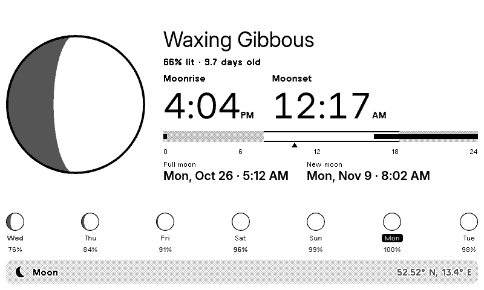
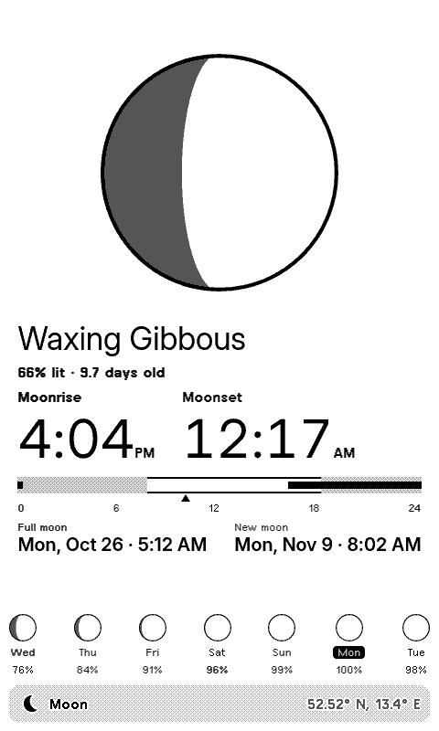
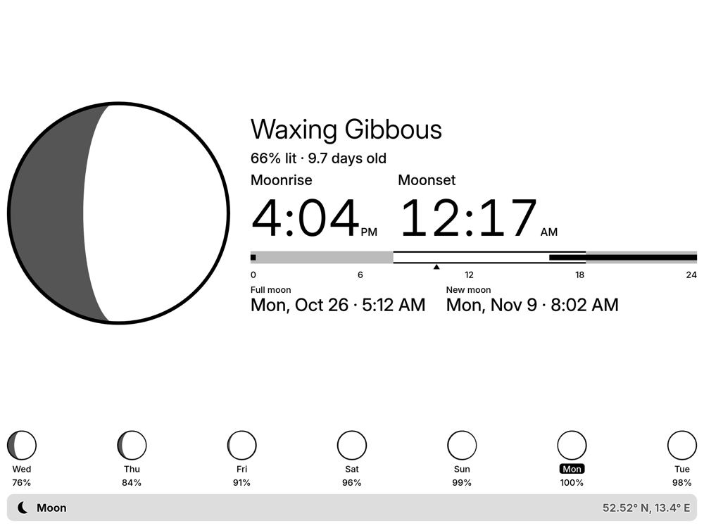
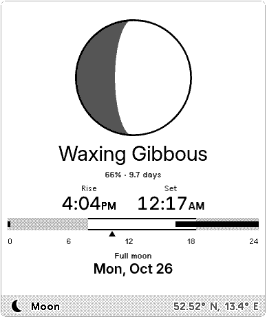
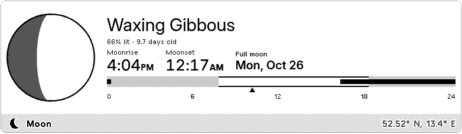
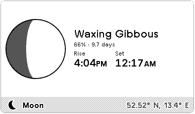

# Moonrise & Moonset

When the moon rises and sets today at your location, for [TRMNL](https://trmnl.com) e-paper displays: a drawn moon in its current phase, a bar across the day showing when the moon is up and when it is night, the next full and new moon, and the moon for the coming week.



| Portrait | TRMNL X | Half (vertical) |
|---|---|---|
|  |  |  |

| Half (horizontal) | Quadrant |
|---|---|
|  |  |

## Features

- Moonrise and moonset for your location and day, to the minute
- The moon drawn in its phase (mirrored south of the equator), with the phase name, how much is lit and its age
- A day bar from midnight to midnight: moon above the horizon in black, night in gray, now marked
- Next full and new moon with date and time, and a strip with the moon for the next 7 days
- The far north and south: days without a moonrise or moonset, or with the moon up or down all day
- German or English (or follow the TRMNL account language), 24-hour or 12-hour times
- All four TRMNL layouts (full, half horizontal, half vertical, quadrant), adapting to portrait and to TRMNL X

## Data

Everything about the moon is computed in the plugin, so it needs no moon service, account or API key:

- Moon position: Jean Meeus, *Astronomical Algorithms* (2nd ed., 1998), ch. 47 (ELP-2000/82, every term above 0.0005°), with the sun from ch. 25, illumination from ch. 48 and the principal phases from ch. 49.
- Moonrise and moonset: the moon's upper limb crossing the horizon, with 34′ of refraction and topocentric parallax, found in 10-minute steps and refined to the second.

Checked against the [US Naval Observatory](https://aa.usno.navy.mil/data/RS_OneDay) for Berlin, New York, Sydney, Tromsø and Longyearbyen on 76 dates in 2026: rise and set within a minute (USNO rounds to the minute), all 50 principal phases of 2026 within a minute, illumination within half a percent, and the same days without a rise or set in the far north.

Sunrise and sunset for the day bar: [Weather data by Open-Meteo.com](https://open-meteo.com/), [CC BY 4.0](https://creativecommons.org/licenses/by/4.0/). If Open-Meteo doesn't answer, the bar shows the moon without the night. This project is not affiliated with or endorsed by the USNO or Open-Meteo.

## How it works

1. TRMNL polls Open-Meteo for today's sunrise and sunset at the chosen location ([`src/settings.yml`](src/settings.yml)).
2. A serverless transform computes the moon for the location and time zone from the plugin settings, and the lit part of each moon as an SVG path ([`src/transform.py`](src/transform.py)).
3. The views lay it out with TRMNL's framework classes; the moon's dark side is the framework's gray, dithered on black-and-white screens ([`src/shared.liquid`](src/shared.liquid)).

## Development

Uses [trmnlp](https://github.com/usetrmnl/trmnlp) through Docker, no Ruby needed:

```sh
bin/trmnlp serve   # live preview at http://localhost:4567
bin/trmnlp lint
bin/trmnlp test
```

The preview uses Berlin. With the `trmnl_preview` gem installed, `TRMNL_LAT_LON="lat,lon"` overrides it without touching tracked files.

## License

[MIT](LICENSE)
